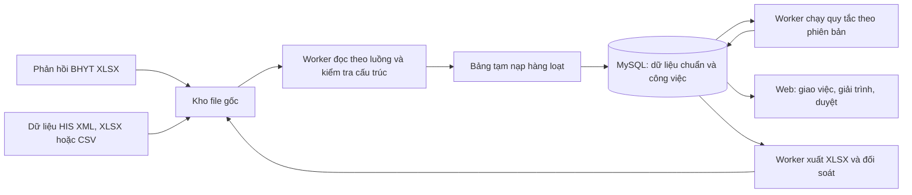

# Đề xuất công cụ quản lý giải trình dữ liệu BHYT

## 1. Kết quả khảo sát dữ liệu mẫu

Thư mục khảo sát hiện có **19 CSV** được chuyển từ XLSX để phân tích. **Luồng phản hồi BHYT** nhận và xuất lại XLSX; **luồng tự kiểm tra trước khi gửi** nhận dữ liệu HIS dạng **XML gửi giám định, XLSX hoặc CSV đủ trường cần kiểm tra**. Các mẫu phản hồi cùng kỳ quyết toán `202607`, mã cơ sở `68001`. Có **101.026 dòng chi phí** thuộc **27.630 lượt khám chữa bệnh** (`MA_LK`) và **98.340 `ID_CP` riêng biệt**. Trong đó có **100.430 dòng mang kết luận từ chối**, **93 cảnh báo**, **503 chấp nhận**. Ba file có thêm một dòng tổng hợp không có `ID_CP`; dòng này không phải việc giải trình nhưng phải được giữ nguyên khi xuất lại.

Hai nhóm `9065` và `9092` có **90.323 dòng**, chiếm khoảng **89,4%** khối lượng. Có **67.459 dòng** mang `MA_KHOA=K01`, `TEN_KHOA` trống: theo nghiệp vụ bệnh viện đây là **khám ngoại trú**, cần gom vào luồng ngoại trú hoặc chia theo người thực hiện/người chỉ định, không coi là dữ liệu lỗi. Có **2.149 `ID_CP` xuất hiện ở nhiều file**. Vì một chi phí có thể bị nêu theo nhiều quy tắc, mỗi dòng trong mỗi file phải là một việc giải trình riêng.

Cấu trúc mẫu thay đổi từ **115 đến 137 cột**; từng tháng có thể phát sinh mã lỗi, cột và thứ tự cột mới. Một số tệp có tiêu đề cột trùng nhau (ví dụ `NGAY_YL`, `NGAY_RA`, `MOI_MA_CP`) hoặc tiêu đề có khoảng trắng bao quanh (` TIEN_DE_NGHI_KIEM_TRA `). Không được gộp dữ liệu theo tên cột rồi xuất lại vì sẽ mất cột hoặc đổi vị trí. Các trường số tiền cũng không đồng nhất: có dạng `502549`, có dạng `502.549,00`. `KET_LUAN` của file `5073` còn chứa cả dòng “Chấp nhận”; không nên giao các dòng này như khoản bị từ chối.

Ở **mọi dòng `K01` trong mẫu**, `MA_BAC_SI` có giá trị. Với `9065`, `MA_BSI_THUC_HIEN` chỉ có ở **25.825/49.052 dòng `K01`**; với `9092`, trường này có ở **9.764/9.764 dòng `K01`**. Vì vậy cơ chế giao trực tiếp cho người thực hiện phải có đường dự phòng khi mã người thực hiện thiếu hoặc chưa nối được với tài khoản.

### Danh mục quy tắc và hướng giao việc ban đầu

| Mã | Số dòng cần theo dõi | Nội dung lỗi theo tên file/dữ liệu | Đầu mối giải trình đề xuất | Phối hợp |
|---|---:|---|---|---|
| 2109 | 33 | Diosmin không phù hợp chẩn đoán | Khoa kê đơn | Dược lâm sàng |
| 2123 | 28 | Chỉ định điện tim thường | Khoa chỉ định | Đơn vị thực hiện điện tim |
| 3008 | 25 | Bác sĩ chỉ định thuốc khi đang thực hiện DVKT cho người khác | Khoa của bác sĩ chỉ định | Đơn vị thực hiện, CNTT/HIS |
| 3014 | 647 | Cấp thuốc chồng giữa các đợt điều trị | Khoa kê đơn | Khoa Dược, bộ phận BHYT |
| 3020 | 6.160 | Chỉ định thuốc trước xét nghiệm/CĐHA/TDCN | Khoa chỉ định | Đơn vị cận lâm sàng, CNTT/HIS |
| 3022 | 33 | Chỉ định thuốc trước khám bệnh | Khoa khám/chỉ định | CNTT/HIS |
| 3027 | 15 | Azithromycin vượt liều | Khoa kê đơn | Dược lâm sàng |
| 3034 | 1 | Thuốc chống chỉ định | Khoa kê đơn | Dược lâm sàng |
| 3130 | 13 | Chỉ định xét nghiệm acid uric | Khoa chỉ định | Khoa Xét nghiệm |
| 5066 | 561 | Giờ có kết quả ngoài thời gian điều trị | Đơn vị thực hiện | Khoa điều trị, CNTT/HIS |
| 5069 | 829 | Giờ thực hiện ngoài thời gian điều trị | Đơn vị thực hiện | Khoa điều trị, CNTT/HIS |
| 5071 | 9 | Giờ y lệnh ngoài thời gian điều trị | Khoa chỉ định | CNTT/HIS, bộ phận hồ sơ bệnh án |
| 5073 | 1.146 | Cùng nhân viên, cùng dịch vụ, cùng phút | Đơn vị thực hiện | CNTT/HIS, bộ phận BHYT; chỉ **643 dòng từ chối** cần giải trình, **503 dòng chấp nhận** chỉ cần lưu/kiểm tra |
| 9006 | 604 | Chỉ định urê/creatinin theo chẩn đoán | Khoa chỉ định | Khoa Xét nghiệm |
| 9024 | 555 | Chỉ định glucose máu theo chẩn đoán | Khoa chỉ định | Khoa Xét nghiệm |
| 9031 | 25 | Chỉ định điện tim theo mã bệnh | Khoa chỉ định | Đơn vị thực hiện điện tim |
| 9065 | 76.250 | Thời gian thực hiện DVKT bằng 0 | **Đơn vị thực hiện dịch vụ** | CNTT/HIS, khoa điều trị |
| 9092 | 14.073 | Thời lượng thực hiện CĐHA dưới mức nêu trong dữ liệu | **Đơn vị thực hiện CĐHA** | CNTT/HIS, khoa chỉ định |
| 9281 | 19 | Trimetazidin và chẩn đoán đau thắt ngực | Khoa kê đơn | Dược lâm sàng |

“Đầu mối” trong bảng là **đơn vị theo dõi**, còn **người được giao việc** là cá nhân chịu trách nhiệm trên dòng dữ liệu. Quy tắc khởi tạo cần được bệnh viện phê duyệt bằng danh mục mã khoa, nhân sự và đơn vị thực hiện. Với nhóm lỗi về trình tự/thời gian, một dòng có thể cần hai ý kiến: người chỉ định xác nhận hồ sơ và người thực hiện/đơn vị kỹ thuật xác nhận thời điểm ghi nhận. Riêng `K01` là luồng ngoại trú; có thể báo cáo tập trung nhưng vẫn giao giải trình đến cá nhân khi xác định được.

## 2. Luồng làm việc đề xuất

1. **Tiếp nhận đợt:** nhân viên BHYT tải một hoặc nhiều **XLSX**; hệ thống ghi tên tệp, hash, kỳ, cơ sở, người và thời điểm nạp. Kiểm tra trùng tệp trước khi tạo công việc. Mỗi kỳ là một đợt độc lập; mã lỗi, cột mới và biến thể biểu mẫu được xem trước để quản lý duyệt ánh xạ rồi mới phân công. Lỗi chưa có trong thư viện được tự ghi nhận là **lỗi mới chờ phân loại** và vẫn đi vào luồng giải trình.
2. **Bóc tách an toàn:** nhận diện trang tính dữ liệu và dòng tiêu đề trong XLSX, cho quản lý chọn lại nếu nhận diện sai. Đọc theo luồng để xử lý tệp lớn; lưu trang tính, nguyên tên cột, thứ tự cột, từng ô và số dòng nguồn. Nhận mã lỗi `TACH_####` từ tên tệp, đối chiếu `GHI_CHU`, `KET_LUAN`, `MA_KHOA`, `MA_BAC_SI`, `MA_BSI_THUC_HIEN`, `TEN_NVYT_THUC_HIEN`, `LOAI_CP` và các cột mở rộng theo mã lỗi. Dòng tổng hợp được nhận diện và giữ riêng.
3. **Phân công đến người trực tiếp giải trình:** quy tắc mã lỗi xác định vai trò chịu trách nhiệm: lỗi **chỉ định/kê đơn** ưu tiên người ở `MA_BAC_SI`/`TEN_NHAN_VIEN_CHI_DINH`; lỗi **thực hiện/kết quả/thời lượng** ưu tiên `MA_BSI_THUC_HIEN`/`TEN_NVYT_THUC_HIEN` và đơn vị thực hiện. Dùng mã nhân sự và danh mục tài khoản bệnh viện để giao đến **người thực hiện cụ thể**, đồng thời gắn khoa quản lý để theo dõi/duyệt. Với `K01`, quản lý có thể chọn **một nhóm ngoại trú chung** hoặc **tách theo người thực hiện/người chỉ định** cho từng mã lỗi/đợt; mặc định ưu tiên tách theo người chịu trách nhiệm. Nếu thiếu mã người thực hiện, chuyển vào hàng chờ của đầu mối ngoại trú để phân tiếp, không tự gán người chỉ định là người thực hiện. Cho phép đổi người/khoa phụ trách và lưu lý do.
4. **Giải trình:** khoa nhận danh sách lọc theo mã lỗi, người phụ trách, trạng thái và hạn xử lý. Mỗi dòng có nguyên văn ghi chú từ BHYT, các trường liên quan và liên kết hồ sơ/evidence. Người xử lý ghi nội dung giải trình, chọn hướng xử lý (đề nghị chấp nhận, chấp nhận xuất toán, cần chỉnh dữ liệu, chuyển đơn vị khác), đính kèm minh chứng, chuyển duyệt.
5. **Duyệt và tổng hợp:** trưởng khoa/đầu mối BHYT duyệt hoặc trả lại; quản lý theo dõi số dòng và số tiền theo file, mã lỗi, khoa, trạng thái. Các dòng cảnh báo được đưa vào diện xem xét; dòng đã được BHYT đánh dấu “Chấp nhận” không chặn tiến độ giải trình.
6. **Xuất trả:** tạo **một XLSX kết quả cho từng XLSX đầu vào**, giữ nguyên thứ tự và mọi cột/dòng gốc của trang dữ liệu, chỉ nối thêm cột cuối **`ĐÃ GIẢI TRÌNH`**. Nội dung cột là bản giải trình đã duyệt; dòng tổng hợp và dòng “Chấp nhận” có thể để trống theo quy tắc xuất đã được xác nhận. Giữ các trang tính khác nếu có; kiểm thử với XLSX gốc để xác nhận mức giữ nguyên định dạng, kiểu ô và công thức. Có thể cung cấp thêm báo cáo tổng hợp nội bộ, nhưng không dùng nó thay các tệp gốc.

### Cấu hình cột hiển thị cho quản lý và khoa phòng

- Trên danh sách công việc, quản lý mở **Chọn cột**, tick bật/tắt từng cột nguồn hoặc cột nghiệp vụ (mã lỗi, người được giao, trạng thái, giải trình, hạn xử lý). Có tìm kiếm tên cột, xem trước danh sách với vai trò của khoa/phòng và nút khôi phục mặc định. Thao tác này chỉ đổi **giao diện**, không xóa dữ liệu và không đổi cấu trúc XLSX xuất trả.
- Có **cấu hình mặc định** do quản lý lưu theo mã lỗi/nhóm lỗi và vai trò người xem; có thể đặt riêng cho từng khoa hoặc từng đợt. Cấu hình tạm của một lần xem không ghi đè mặc định. Người quản lý có thể đổi mặc định cho các đợt sau, và mỗi đợt vẫn lưu phiên bản cấu hình đã dùng để tra cứu.
- Gợi ý mặc định: hiển thị mã lỗi, `ID_CP`, `MA_LK`, kết luận, ghi chú, mã/tên chi phí, số tiền liên quan, người chỉ định, người thực hiện, người được giao và trạng thái; thêm cột theo lỗi, ví dụ `NGAY_YL`/`NGAY_TH_YL`/`NGAY_KQ` cho lỗi thời gian, `MA_BENH` cho lỗi chỉ định, liều/số lượng cho lỗi thuốc. Quản lý được tự do tick bỏ các cột khi không cần xem.
- Cấu hình dựa trên **tên cột chuẩn hóa + lần xuất hiện** để chịu được việc đổi thứ tự cột; khi tháng sau thiếu cột thì bỏ qua và báo trên màn hình, khi xuất hiện cột mới thì hiện trong mục “Cột mới” để quản lý quyết định. Với tiêu đề trùng, hiển thị thêm vị trí gốc để người dùng phân biệt. Mở chi tiết một dòng vẫn xem được toàn bộ dữ liệu nguồn.

### Trạng thái công việc

`Chưa phân công → Đã giao → Đang giải trình → Chờ duyệt → Đã duyệt → Đã xuất`; nhánh phụ `Trả lại` và `Cần điều phối`. Trạng thái công việc nằm trong hệ thống, không sửa các cột `KET_LUAN` hay `GHI_CHU` của nguồn. `ĐÃ GIẢI TRÌNH` là nội dung phản hồi gửi đi, không phải kết quả BHYT đã chấp thuận.

## 3. Thư viện lỗi và cơ chế học từ các kỳ giám định

Mỗi đợt phản hồi BHYT là một nguồn bổ sung cho **thư viện lỗi**. Hệ thống so mã lỗi trong tên file, mô tả trong `GHI_CHU`/`KET_LUAN`, loại chi phí và cấu trúc dữ liệu với thư viện hiện có. Trường hợp chưa khớp, hoặc cùng mã nhưng nội dung/điều kiện đã thay đổi, hệ thống mở **phiếu lỗi mới hoặc phiên bản mới**; không gộp tự động chỉ vì trùng mã. Phiếu có số dòng, số tiền tham chiếu, các cột liên quan, vài dòng ví dụ được truy cập theo phân quyền, kỳ phát hiện đầu tiên và người phụ trách phân tích. Quản lý đặt tên dễ hiểu, nhóm lỗi, người phải giải trình, các cột nên hiển thị và mức ưu tiên. Lỗi mới vẫn được phân công thủ công trong kỳ hiện tại.

Một mục thư viện gồm hai phần có vòng đời khác nhau:

| Phần | Nội dung | Kết quả sử dụng |
|---|---|---|
| **Danh mục lỗi** | Mã, tên, mô tả, nhóm chuyên môn, nguồn phát hiện, ví dụ, người giải trình, mẫu cột và mẫu nội dung giải trình | Dùng ngay để nhận diện, phân phối và thống kê lỗi trả về |
| **Quy tắc tự kiểm tra** | Điều kiện có thể tính được, dữ liệu đầu vào cần có, phạm vi áp dụng, ngoại lệ, thời điểm hiệu lực, mức cảnh báo và các ca kiểm thử | Chỉ chạy trước khi gửi BHYT sau khi được thẩm định và duyệt |

Vòng đời quy tắc: `Mới ghi nhận → Đang phân tích → Đang thử nghiệm → Được duyệt → Đang áp dụng → Tạm dừng/Ngừng áp dụng`. Một lỗi có thể ở thư viện nhưng mang trạng thái **chỉ giải trình thủ công** nếu cần đánh giá chuyên môn hoặc dữ liệu xuất từ HIS chưa đủ để kiểm tra. Tên file, câu ghi chú của BHYT và một số dòng bị từ chối là **gợi ý xây dựng quy tắc**, chưa đủ để khẳng định điều kiện chính xác cho mọi hồ sơ.

Giao diện soạn quy tắc hỗ trợ điều kiện có cấu trúc như so sánh hai trường, kiểm tra khoảng thời gian, tập mã chẩn đoán/dịch vụ và so bản ghi liên quan; kèm bản xem thử trên dữ liệu mẫu. Quy tắc phức tạp được CNTT bổ sung thành bộ kiểm tra có mã nguồn và kiểm thử riêng, rồi đăng ký vào cùng thư viện phiên bản. Việc sửa mô tả lỗi hoặc cấu hình cột không tự thay đổi logic kiểm tra.

Trước khi duyệt quy tắc tự kiểm tra, bộ phận BHYT cùng khoa chuyên môn/CNTT xác nhận: điều kiện và ngoại lệ, trường dữ liệu bắt buộc, kiểu ngày giờ/đơn vị tính, phạm vi nội trú/ngoại trú, ngày bắt đầu và kết thúc áp dụng, người chịu trách nhiệm xử lý kết quả. Thử trên dòng từng bị từ chối **và** dữ liệu đã được chấp nhận để xem cảnh báo sai; lưu bộ ca đúng/sai/thiếu dữ liệu và người duyệt. Mọi thay đổi tạo **phiên bản mới**; kết quả đã chạy giữ mã phiên bản cũ để đối chiếu được. Định kỳ đối chiếu kết quả tự kiểm tra với phản hồi BHYT kỳ sau để cập nhật quy tắc.

## 4. Tự kiểm tra trước khi gửi giám định BHYT

1. Đơn vị **xuất dữ liệu chuẩn bị gửi BHYT từ HIS dưới dạng XML gửi giám định, XLSX hoặc CSV** và nạp vào một đợt **Tự kiểm tra**. Bộ đọc XML nhận diện `GIAMDINHHS/HOSO/FILEHOSO/LOAIHOSO/NOIDUNGFILE`, sau đó tách XML1 và các bảng chi tiết; bộ đọc XLSX/CSV ánh xạ trang tính/tệp, cột và kiểu dữ liệu. CSV cần cấu hình mã hóa, dấu phân cách, dòng tiêu đề, định dạng số/ngày; một tệp phẳng hoặc bộ nhiều tệp có thể đại diện cho nhiều bảng nguồn. Mỗi kiểu xuất HIS có **cấu hình ánh xạ riêng, có phiên bản**, đưa về cùng bộ trường chuẩn để dùng chung thư viện quy tắc. Màn hình xem trước cho thấy trường đã khớp, trường thiếu, bản ghi lặp và số hồ sơ/dòng chi phí trước khi chạy. Khi cần nối nhiều bảng/trang/tệp hoặc nhánh XML, hệ thống dùng khóa có trong nguồn (`MA_LK`, loại bảng, `STT`, mã dịch vụ/thuốc, thời điểm); chỉ dùng `ID_CP` khi đầu vào thực sự có trường này, phát hiện khóa trùng/thiếu/mơ hồ trước khi chạy.
2. Người quản lý chọn **bộ quy tắc đã duyệt** theo kỳ áp dụng và loại dữ liệu. Hệ thống chụp lại phiên bản bộ quy tắc, hash file đầu vào, định dạng nguồn và cấu hình ánh xạ, rồi chạy nền. Quy tắc chạy trên bộ trường chuẩn nên cùng một điều kiện cho kết quả tương đương khi XLSX và XML chứa cùng dữ liệu. Quy tắc đơn giản kiểm tra trên một dòng; quy tắc nhiều dòng có thể so giờ y lệnh/kết quả, một nhân viên thực hiện trùng thời điểm, hoặc đơn thuốc giữa các đợt. Quy tắc chỉ chạy khi đủ dữ liệu cần thiết.
3. Kết quả có ba trạng thái: **phát hiện nguy cơ**, **không phát hiện theo quy tắc đã chạy**, **không đủ dữ liệu để kiểm tra**. Mỗi phát hiện chỉ ra dòng/hồ sơ liên quan, mã và phiên bản quy tắc, giá trị gây cảnh báo, giải thích ngắn và người nhận xử lý. Màn hình nêu rõ số dòng được kiểm tra và số dòng không đủ dữ liệu theo từng quy tắc.
4. Phát hiện được giao cho **người chỉ định/người thực hiện** và khoa quản lý như luồng giải trình. Người xử lý sửa dữ liệu ở hệ thống nguồn hoặc ghi nhận lý do giữ nguyên; nạp bản xuất mới để chạy lại, đối chiếu số cảnh báo trước/sau. Quản lý xuất **báo cáo tự kiểm tra XLSX** gồm phát hiện, việc đã xử lý, ngoại lệ được duyệt và độ phủ quy tắc để rà soát trước khi gửi giám định.
5. Khi BHYT trả kết quả kỳ đó, hệ thống đối chiếu phản hồi với lần tự kiểm tra đã lưu theo hồ sơ/dòng chi phí và mã lỗi. Ghi nhận **bắt đúng, cảnh báo sai, lỗi lọt và trường hợp không kiểm tra được** để ưu tiên sửa thư viện. Không dùng tỷ lệ này như độ chính xác tuyệt đối khi dữ liệu đầu vào hoặc quy định áp dụng đã thay đổi.

Phạm vi tự kiểm tra phụ thuộc dữ liệu HIS xuất được. Ví dụ, nhóm `9065` cần thời điểm bắt đầu/kết thúc hoặc thực hiện/kết quả đủ chuẩn; nhóm `3014` cần liên kết đơn thuốc giữa các đợt, có thể vượt phạm vi một file. Hệ thống phải báo **không kiểm tra được** khi thiếu các trường đó, thay vì báo hồ sơ đạt.

Với XML, mỗi phát hiện lưu **đường dẫn phần tử, số thứ tự `HOSO`, `LOAIHOSO`, `STT` dòng chi tiết và `MA_LK`** để người xử lý tìm lại đúng bản ghi. Mẫu `Data_gui-Giam_dinh.xml` chứa XML con **lồng trực tiếp** trong `NOIDUNGFILE`, không phải chuỗi base64; bộ đọc phải hỗ trợ đúng biến thể này và chỉ mở rộng sang biến thể khác khi có mẫu xác nhận. Cần kiểm tra cấu trúc XML, namespace, định dạng ngày/giờ và kiểu mã trước khi ánh xạ; XML không hợp lệ hoặc thiếu nhánh bắt buộc được báo riêng, còn nhánh không áp dụng có thể rỗng. Bộ đọc XML xử lý theo luồng với tệp lớn, chặn tham chiếu thực thể bên ngoài và giới hạn tài nguyên xử lý. Khi đối chiếu phát hiện với XLSX BHYT trả về, nếu XML không có `ID_CP`, dùng bộ khóa/cột đối chiếu được thẩm định và đưa trường hợp nhiều ứng viên vào hàng chờ xác nhận, không tự ghép theo riêng `MA_LK`.

## 5. Công nghệ xử lý và thiết kế cơ sở dữ liệu cho quy mô lớn

### Công nghệ đề xuất

| Thành phần | Lựa chọn đề xuất | Cách dùng |
|---|---|---|
| Giao diện | Laravel Blade; thêm Vue/TypeScript cho bảng công việc tương tác nếu cần | Bảng công việc phân trang phía máy chủ, chọn cột, giải trình và duyệt; không tải hàng triệu dòng vào trình duyệt |
| API và tác vụ nền | [Laravel 13 trên PHP 8.3](https://laravel.com/framework/docs/releases); [Laravel Queue](https://laravel.com/framework/docs/queues) với worker CLI | API phục vụ người dùng; job theo file/khối thực hiện nạp, đối chiếu, chạy quy tắc, xuất file. Worker chạy tách khỏi PHP-FPM, có checkpoint trong DB và chạy lại an toàn |
| Đọc/ghi XLSX | [OpenSpout](https://github.com/openspout/openspout) nhánh tương thích PHP 8.3 để đọc/ghi báo cáo lớn theo luồng; PHP `ZipArchive` + `XMLReader` cho luồng cần giữ workbook gốc | Không nạp toàn bộ bảng vào RAM. Khóa phiên bản thư viện trong `composer.lock` vì nhánh OpenSpout mới có thể yêu cầu PHP khác. Với XLSX phản hồi BHYT cần giữ nguyên, thiết kế xuất theo hướng sao chép gói OOXML và bổ sung cột vào trang dữ liệu; kiểm chứng tính tương thích bằng XLSX gốc trước khi chốt cách ghi |
| Đọc XML/CSV HIS | PHP [XMLReader](https://www.php.net/manual/en/class.xmlreader.php) và `SplFileObject`/bộ đọc CSV theo luồng | Đọc tuần tự `HOSO`/dòng CSV, xử lý XML con lồng trong `NOIDUNGFILE`, ánh xạ từng mẫu nguồn về các bảng dữ liệu chuẩn |
| Cơ sở dữ liệu | MySQL 8.4 LTS/InnoDB | Lưu dữ liệu đã chuẩn hóa để lọc, giao việc, chạy quy tắc và đối soát; dùng [LOAD DATA](https://dev.mysql.com/doc/refman/8.4/en/loading-tables.html) từ vùng tạm được kiểm soát để nạp hàng loạt vào bảng staging |
| Kho file | Kho nội bộ hoặc object storage tương thích S3 do bệnh viện quản lý | Lưu XLSX/XML/CSV nguồn bất biến, file kết quả, minh chứng và hash; DB lưu đường dẫn, phiên bản và quyền truy cập |

Khởi đầu bằng **một ứng dụng Laravel và một nhóm worker nền dùng chung MySQL**, triển khai tách tiến trình để nhập/xuất không làm chậm màn hình giải trình. Hàng đợi ban đầu có thể dùng driver database của Laravel; số job nên tính theo file/khối, không tạo một job cho từng dòng. Chỉ thêm Redis hoặc dịch vụ tìm kiếm khi bài đo tải thực tế cho thấy cần. Đây là lựa chọn kiến trúc theo hạ tầng dev hiện có, cần đối chiếu với năng lực vận hành VPS của bệnh viện.

### Môi trường phát triển và triển khai

- **Dev Windows/Laragon:** máy hiện có PHP **8.3.33**, MySQL **8.4.3**, Nginx và Composer; các extension `pdo_mysql`, `xmlreader`, `zip` đã bật. Thiết lập Composer và lệnh Artisan dùng đúng PHP của Laragon; hiện lệnh `php` trên PATH lại trỏ tới XAMPP 8.2.12. Dev và production dùng cùng nhánh PHP 8.3, cùng dòng MySQL 8.4, cùng `composer.lock` và phiên bản thư viện nạp file đã khóa.
- **Production Ubuntu 22.04 VPS:** triển khai Nginx, PHP-FPM **8.3**, MySQL **8.4**, tiến trình worker Laravel và kho file riêng tư; có TLS, sao lưu và giám sát. Cách triển khai đề xuất là [Docker Compose trên một VPS](https://docs.docker.com/compose/how-tos/production/) với dịch vụ web, app, worker, DB; phiên bản image được khóa, worker có chính sách tự khởi động lại, volume dữ liệu bền vững và quy trình sao lưu độc lập. Ubuntu 22.04 mặc định dùng [PHP 8.1](https://packages.ubuntu.com/jammy/all/php), trong khi Laravel 13 cần [PHP ít nhất 8.3](https://laravel.com/framework/docs/deployment); image PHP 8.3 giữ đúng nhánh runtime giữa dev và production. Nếu giữ Ubuntu 22.04 lâu dài, cần kế hoạch nâng cấp hoặc gói hỗ trợ mở rộng vì [bảo trì bảo mật tiêu chuẩn kết thúc năm 2027](https://ubuntu.com/about/release-cycle).
- **Cấu hình:** `.env` riêng cho từng môi trường; tài khoản DB và mật khẩu không nằm trong mã nguồn. File chứa dữ liệu bệnh nhân chỉ nằm trong thư mục/volume riêng tư, không nằm dưới web root. Thử khôi phục DB và kho file trên bản sao trước khi vận hành chính thức.



### Cách lưu hàng triệu dòng

- **Kho file là nguồn đối chiếu nguyên bản.** Lưu file đã nạp theo hash và phiên bản. Với dữ liệu HIS dùng để tự kiểm tra, DB chỉ lưu trường chuẩn cần tìm kiếm/kiểm tra và vị trí bản ghi trong nguồn; tránh nhân đôi mọi trường XML/XLSX/CSV cho hàng triệu dòng. Với **dòng phản hồi BHYT**, để chọn hiển thị tự do trong 115–137 cột, lưu thêm mảng giá trị ô theo đúng thứ tự cột trong kiểu [JSON của MySQL](https://dev.mysql.com/doc/refman/8.4/en/json.html); chỉ lập chỉ mục cho các trường lọc thường dùng đã tách thành cột có kiểu dữ liệu rõ ràng. File gốc vẫn là nguồn đối soát khi xuất.
- **Bảng quan hệ chính:** `import_batch`, `source_file`, `claim/visit`, `cost_line`, `issue_case`, `assignment`, `explanation`, `rule_version`, `precheck_run`, `finding`, `column_preset`, `audit_event`. Một dòng chi phí có thể có nhiều `issue_case`; khóa vụ việc gồm kỳ/đợt + file + trang/dòng, không lấy riêng `ID_CP` làm khóa.
- **Bắt đầu với InnoDB và chỉ mục theo kỳ.** Hàng triệu dòng không tự buộc phải phân vùng. Nếu đo tải sau này cho thấy cần chia theo tháng, cân nhắc phân vùng cho **bảng dữ liệu kiểm tra/staging độc lập** hoặc lưu trữ kỳ đã đóng. Các bảng công việc có quan hệ khóa ngoại cần xem xét riêng vì [MySQL InnoDB không hỗ trợ khóa ngoại trên bảng phân vùng](https://dev.mysql.com/doc/refman/8.4/en/partitioning-limitations-storage-engines.html); mọi khóa duy nhất của bảng phân vùng còn phải chứa khóa phân vùng. Quy tắc so giữa các kỳ phải giữ các kỳ liên quan trong dữ liệu truy vấn được.
- **Chỉ tạo chỉ mục phục vụ truy vấn thật:** chỉ mục ghép cho `(ky, id_cp)`, `(ky, ma_lk)`, `(ky, assignee_id, status)` và khóa nối của quy tắc; rà soát bằng [EXPLAIN của MySQL](https://dev.mysql.com/doc/refman/8.4/en/using-explain.html) trước khi thêm. Chỉ mục thừa làm tăng chi phí ghi dữ liệu, như [tài liệu MySQL](https://dev.mysql.com/doc/refman/8.4/en/optimization-indexes.html) nêu rõ. Báo cáo tổng hợp theo mã lỗi/khoa/trạng thái lấy từ bảng đếm cập nhật theo đợt hoặc truy vấn nền, không quét toàn bộ khi mỗi người mở màn hình.
- **Phân trang theo khóa/cursor** khi người dùng cuộn qua danh sách lớn, kết hợp lọc tại DB; không dùng `OFFSET` sâu cho việc xuất hay duyệt tuần tự. Tách dữ liệu đang xử lý với dữ liệu đã đóng kỳ bằng chính sách lưu trữ và sao lưu được bệnh viện phê duyệt.

### Quy trình nạp, kiểm tra và xuất

1. Ghi file gốc vào kho, kiểm hash và cấu trúc. Worker đọc từng bản ghi bằng OpenSpout/`XMLReader`/bộ đọc CSV theo luồng, chuẩn hóa mã/ngày giờ/số tiền, ghi lỗi định dạng kèm vị trí nguồn; không tạo danh sách hàng triệu dòng trong RAM.
2. Nạp theo khối vào **bảng staging** bằng `LOAD DATA` từ vùng tạm chỉ worker/DB được phép đọc, đối soát số bản ghi rồi chuyển sang bảng chuẩn trong các giao dịch có giới hạn. Bước nào lỗi có thể chạy lại từ checkpoint; khóa bất biến và hash ngăn tạo việc trùng. Không bật `LOAD DATA LOCAL` rộng rãi; [MySQL lưu ý rủi ro truy cập file phía máy khách](https://dev.mysql.com/doc/refman/8.4/en/load-data-local-security.html).
3. Chạy quy tắc đơn giản bằng truy vấn theo tập hợp trên các bảng đã chuẩn hóa; quy tắc nhiều dòng dùng khóa nối và khoảng thời gian phù hợp. Chia công việc theo kỳ/file hoặc miền khóa không chồng nhau; giới hạn số worker song song theo CPU, RAM và tải DB đo được. Lưu kết quả cùng phiên bản quy tắc và độ phủ.
4. Khi xuất giải trình, đọc bản XLSX BHYT gốc và ghép nội dung đã duyệt bằng khóa file + trang/dòng; xuất theo luồng, kiểm lại số dòng, thứ tự, giá trị nguồn và cột mới. Báo cáo tự kiểm tra mới có thể dùng OpenSpout. Một trang Excel tối đa [1.048.576 dòng](https://support.microsoft.com/en-us/excel/excel-specifications-and-limits); báo cáo lớn hơn phải chia trang/file và nêu tổng đối soát.

**Đo tải trước triển khai:** bộ CSV phản hồi khảo sát gồm 101.026 dòng và khoảng 106 MiB, tương đương khoảng 1,1 KiB/dòng trong mẫu này; đây chỉ là ngoại suy tham khảo vì XLSX/XML/CSV HIS và kỳ khác có kích thước khác. Dựng bộ thử ít nhất **1 triệu và 5 triệu dòng** với tỷ lệ cột, lỗi và quy tắc gần thực tế. Đo thời gian nạp, tốc độ quy tắc, thời gian xuất, RAM/CPU, dung lượng DB/chỉ mục, thời gian lọc danh sách và khả năng chạy tiếp sau lỗi. Chốt cấu hình máy chủ, kích thước khối, số worker và thời gian hoàn tất dựa trên kết quả đo, rồi giám sát trong vận hành.

Với **một VPS**, bài đo tải còn phải tính đồng thời MySQL, PHP-FPM, worker, file gốc, file tạm khi giải nén/tạo XLSX, binary log và bản sao lưu. Chừa dung lượng cho giai đoạn xử lý cao điểm; khi khối lượng hoặc thời gian xử lý vượt mục tiêu đã thống nhất, tách DB hoặc kho file sang máy/dịch vụ riêng mà không đổi mô hình dữ liệu nghiệp vụ.

**Vận hành và bảo vệ dữ liệu:** phân quyền ở API theo người được giao/khoa/vai trò, kiểm thử các truy vấn danh sách và tải file để tránh lộ hồ sơ ngoài phạm vi. Mã hóa kết nối và kho lưu file, tách tài khoản đọc/ghi tác vụ, ghi nhật ký truy cập và thay đổi giải trình. Sao lưu cả DB lẫn kho file, định kỳ thử khôi phục; MySQL hỗ trợ [khôi phục theo thời điểm từ bản sao lưu và binary log](https://dev.mysql.com/doc/refman/8.4/en/backup-types.html). Giám sát hàng đợi, tốc độ nạp, số dòng lỗi ánh xạ, dung lượng đĩa, thời gian truy vấn và tình trạng sao lưu.

## 6. Mô hình dữ liệu và quy tắc kỹ thuật tối thiểu

- **Đợt nhập / tệp nguồn:** mã đợt, kỳ, mã cơ sở, tên XLSX, hash SHA-256, danh sách trang tính, cấu trúc cột gốc, phiên bản và nhật ký nạp.
- **Dòng nguồn:** `source_file_id + sheet_id + row_number` là khóa bất biến cho phản hồi XLSX. Lưu mảng ô theo vị trí, tiêu đề gốc và loại dòng (chi phí/tổng hợp); dữ liệu HIS tự kiểm tra lưu các trường chuẩn và vị trí bản ghi: trang/dòng XLSX, số dòng CSV, hoặc `HOSO` + `LOAIHOSO` + `STT`/đường dẫn XML. `ID_CP`, `MA_LK`, `MA_KHOA` là khóa tra cứu khi nguồn có trường đó, không phải khóa duy nhất của công việc.
- **Vụ việc:** mã lỗi, kết luận, số tiền tham chiếu, nhóm chuyên môn, độ ưu tiên, người chịu trách nhiệm, khoa/nhóm theo dõi, đơn vị phối hợp, trạng thái. Dùng mã nội bộ theo **vị trí cột** khi gặp tiêu đề trùng; vẫn giữ tiêu đề trùng nguyên dạng khi xuất.
- **Phản hồi:** bản nháp, bản được duyệt, người viết, người duyệt, thời gian, minh chứng, lịch sử sửa và lý do chuyển đơn vị.
- **Bảng ánh xạ quản trị:** mã khoa → tên khoa/đầu mối; mã bác sĩ/NVYT → tài khoản người dùng và khoa; mã dịch vụ → đơn vị thực hiện; mã lỗi → vai trò chịu trách nhiệm và thứ tự chọn người. Có ngày hiệu lực để dùng đúng theo kỳ.
- **Cấu hình cột:** phạm vi áp dụng (toàn viện/nhóm lỗi/mã lỗi/khoa/đợt), danh sách cột hiển thị theo thứ tự, người đặt mặc định, thời gian hiệu lực và phiên bản. Cấu hình chỉ phục vụ giao diện; không tác động tệp nguồn hoặc tệp xuất.
- **Thư viện lỗi:** định danh lỗi/biến thể, mã và mô tả BHYT, nhóm lỗi, kỳ phát hiện, dữ liệu mẫu liên kết có phân quyền, người xử lý, mẫu cột và lịch sử thay đổi. Danh mục lỗi giữ được cả lỗi chưa viết thành quy tắc máy.
- **Quy tắc kiểm tra:** định danh và phiên bản, logic kiểm tra, cột/bảng cần có, phạm vi và ngày hiệu lực, ngoại lệ, trạng thái duyệt, bộ ca kiểm thử, người soạn/người duyệt. Không ghi đè phiên bản đã dùng để chạy.
- **Đợt tự kiểm tra / phát hiện:** file XML, XLSX hoặc CSV HIS, định dạng và cấu hình ánh xạ có phiên bản, bộ quy tắc và phiên bản đã chụp, vị trí bản ghi trong nguồn (trang/dòng, số dòng CSV hoặc đường dẫn XML/khóa), kết quả theo từng quy tắc/dòng, lý do không kiểm tra được, người nhận xử lý, lịch sử chạy lại và liên kết phản hồi BHYT sau này.
- **Quyền truy cập:** khoa chỉ xem dòng được giao; quản lý BHYT xem toàn đợt; ghi nhật ký truy cập, tải file, đổi phân công và xuất file. Dữ liệu bệnh nhân cần lưu tập trung, phân quyền theo vai trò và có chính sách lưu/xóa do bệnh viện quyết định.

CSV mẫu của `9065` khoảng 80 MB và 76.250 dòng; dữ liệu các kỳ có thể lớn hơn nhiều. Tìm kiếm/tra cứu theo `ID_CP`, `MA_LK`, khoa, người chỉ định, người thực hiện, người được giao, mã lỗi; lọc và xuất danh sách theo phân quyền. Chỉ truy xuất các cột cần hiện trên trang kết quả hiện tại.

## 7. Kiểm soát chất lượng bắt buộc

Trước khi công bố file trả lại, hệ thống phải xác nhận:

1. Số XLSX xuất = số XLSX nguồn đã chọn; đúng trang tính dữ liệu, số dòng, thứ tự dòng, số cột nguồn và giá trị từng ô nguồn; chỉ có thêm cột cuối trên trang dữ liệu. Các trang tính khác được đối chiếu riêng.
2. Mỗi dòng từ chối/cảnh báo thuộc diện phản hồi có đúng một bản giải trình được duyệt hoặc ngoại lệ có lý do do quản lý xác nhận. Không chặn bởi 503 dòng “Chấp nhận” của `5073` hoặc ba dòng tổng hợp.
3. Không gộp hai vụ việc chung `ID_CP` ở hai file; nạp lại cùng tệp không sinh việc trùng.
4. Chuyển số tiền theo đúng định dạng của cột, không dùng số đã làm tròn để ghép khóa hoặc đối soát. Báo cáo đếm và tiền phải nêu rõ đang dùng cột tiền nào vì `THANH_TIEN_BH`, `T_BHTT_DTL`, `TIEN_DE_NGHI_KIEM_TRA` không đồng nhất.
5. XLSX xuất phải giữ tiếng Việt và văn bản giải trình dạng text, tránh nội dung bắt đầu bằng ký tự công thức bị bảng tính hiểu là lệnh. Ghi hash và người phát hành cho mỗi phiên bản kết quả.
6. Thử cấu hình cột với hai đợt có bộ cột khác nhau: cột ẩn không biến mất trong XLSX xuất, cấu hình mặc định vẫn dùng được, cột mới được báo rõ; thử giao việc `K01` theo người, theo nhóm ngoại trú và trường hợp thiếu người thực hiện.
7. Nạp tệp phản hồi chứa mã lỗi chưa có: tạo mục thư viện ở trạng thái chờ phân loại, vẫn giao được việc và vẫn xuất được giải trình; mã cũ nhưng mô tả/điều kiện khác phải được nêu là biến thể cần xem xét.
8. Với tự kiểm tra, thử ca đúng, ca cảnh báo, ca ngoại lệ và ca thiếu dữ liệu cho từng quy tắc; không tính ca thiếu dữ liệu là đạt. Một lần chạy phải dùng đúng phiên bản quy tắc đã chụp dù thư viện được cập nhật sau đó. Đối soát số hồ sơ đầu vào, số hồ sơ được kiểm tra và báo cáo xuất ra.
9. Chạy cùng một bộ hồ sơ ở các định dạng XML/XLSX/CSV khi nguồn chứa dữ liệu tương đương và đối chiếu khóa hồ sơ, trường chuẩn, số phát hiện, số trường hợp không kiểm tra được. Thử XML con lồng trực tiếp, XML sai cấu trúc, thiếu namespace/nhánh, bản ghi lặp và tệp lớn; thử CSV khác dấu phân cách/mã hóa/định dạng số; lỗi đọc phải chỉ rõ vị trí/nhóm dữ liệu bị ảnh hưởng.
10. Thử ánh xạ chéo XML/CSV với các trường trùng tên nhưng khác nghĩa (`KET_LUAN`, `GHI_CHU`), trường khác tên nhưng có thể cùng nghĩa (`MA_THE_BHYT`/`MA_THE`, `NGUOI_THUC_HIEN`/`MA_BSI_THUC_HIEN`), mốc thời gian khác độ chính xác và hồ sơ không có `ID_CP`; không tự ghép dòng khi khóa chưa đủ duy nhất. Với lỗi `3014`, thử trường hợp hai đợt thuốc cùng xuất hiện và chỉ có một đợt trong dữ liệu nạp.

## 8. Phạm vi triển khai theo giai đoạn

**MVP:** nạp XLSX phản hồi và dữ liệu HIS chuẩn bị gửi dạng **XML/XLSX/CSV**; xem trước trang tính, dòng tiêu đề hoặc cấu trúc XML mới theo tháng; thư viện lỗi tự ghi nhận mã/biến thể mới; danh mục khoa/người dùng do quản lý nhập; giao trực tiếp cho người chỉ định/người thực hiện theo loại lỗi, có nhóm ngoại trú dự phòng; màn hình tick chọn cột và lưu cấu hình mặc định; nhập/duyệt giải trình; bảng tiến độ; xuất lại từng XLSX phản hồi với cột cuối; đối soát số dòng và nhật ký. Tự kiểm tra trong MVP gồm ánh xạ tối thiểu một mẫu XML `GIAMDINHHS` và một mẫu XLSX/CSV HIS vào cùng bộ trường chuẩn, một số quy tắc đơn giản đã được duyệt, ba trạng thái kết quả và báo cáo XLSX trước khi gửi BHYT.

**Giai đoạn tiếp:** tích hợp danh mục khoa, bác sĩ, dịch vụ và thời điểm y lệnh từ HIS để tăng độ chính xác phân công; mở rộng quy tắc nhiều bảng/nhiều đợt như cấp thuốc chồng gối, kiểm tra xung đột thời gian nhân viên; so sánh kết quả tự kiểm tra với phản hồi BHYT để đo lỗi lọt và cảnh báo sai; mẫu giải trình theo mã lỗi; xử lý hàng loạt khi cùng nguyên nhân và cùng bằng chứng; kết nối trực tiếp với cổng BHYT nếu có đặc tả và quyền tích hợp.

### Điều kiện cần xác nhận trước khi xây dựng

1. Danh mục mã bác sĩ/NVYT gắn với tài khoản sử dụng hệ thống, khoa và đơn vị thực hiện dịch vụ; quy tắc người duyệt cho nhóm ngoại trú `K01`.
2. Mẫu XLSX BHYT chấp nhận khi gửi trả: tên chính xác của cột cuối, các dòng “Chấp nhận” và dòng tổng hợp có cần điền nội dung hay không.
3. Một số XLSX gốc ở các kỳ hoặc mã lỗi khác nhau và một file kết quả đã từng được BHYT chấp nhận để thử tính tương thích trang tính, định dạng, công thức và thứ tự cột. Thư mục khảo sát hiện chỉ có CSV.
4. Mẫu **XLSX/CSV** HIS xuất **trước khi gửi giám định** và thêm vài mẫu XML `GIAMDINHHS` ở các kỳ/loại hồ sơ khác nhau, kèm mô tả khóa nối giữa các trang/bảng/tệp/nhánh XML và dữ liệu đã được chấp nhận để kiểm thử quy tắc. Mẫu XML hiện có xác nhận một biến thể cấu trúc nhưng chưa đủ bao quát mọi kỳ; các CSV lỗi hiện có chỉ chứa trường hợp bị trả về, chưa đủ để đánh giá cảnh báo sai của công cụ tự kiểm tra.

## 9. Đánh giá khả năng sử dụng CHECKBHYT

Đã rà soát mã nguồn công khai của [CHECKBHYT tại commit `8052fba` ngày 27/09/2026](https://github.com/buinguyenhong/CHECKBHYT/tree/8052fba30b9bbb3b82de0c68eb066514803ef379). Đây là ứng dụng Python/FastAPI phục vụ **đối soát dữ liệu HIS với danh sách đã gửi BHYT, theo dõi lỗi và kiểm tra một số quy tắc XML**. Repo có giao diện khoa phòng, nhập `listbh.xlsx` và `HoSoLoiChiTiet.xlsx`, đọc SQL Server HIS, báo cáo Excel, bộ kiểm tra XML và công cụ tải dữ liệu từ cổng bằng trình duyệt. Mục tiêu gần với một phần dự án, nhưng định dạng dữ liệu và đơn vị công việc khác với các file `TACH_...xlsx` đang khảo sát.

| Thành phần trong CHECKBHYT | Khả năng dùng cho dự án này | Việc cần làm |
|---|---|---|
| [Đối soát HIS, danh sách đã gửi và lỗi trả về](https://github.com/buinguyenhong/CHECKBHYT/blob/8052fba30b9bbb3b82de0c68eb066514803ef379/Project.md) | Tham khảo luồng phát hiện hồ sơ đã gửi/chưa gửi, lịch sử xử lý và màn hình theo khoa; có thể bổ sung sau khi có quyền đọc HIS | Giữ thành luồng riêng; không lấy `MA_LK` làm khóa duy nhất của việc giải trình từng dòng chi phí |
| [Bộ đọc XML và kiểm tra quy tắc](https://github.com/buinguyenhong/CHECKBHYT/tree/8052fba30b9bbb3b82de0c68eb066514803ef379/web_app/xml_validator) | Tham khảo cách gom hồ sơ theo `MA_LK` và trả phát hiện có mã quy tắc | Bộ tách `GIAMDINHHS` của repo đang đọc `NOIDUNGFILE` như base64, trong khi mẫu HIS tại mục 11 chứa XML con lồng trực tiếp; cần viết bộ đọc phù hợp và hỗ trợ đến XML15 theo mẫu thực tế. Đối chiếu từng quy tắc với dữ liệu HIS/đặc tả, chuyển sang bộ quy tắc có phiên bản/duyệt/kiểm thử. Tài liệu nêu 26 quy tắc nhưng mã có quy tắc `B2` đang tắt, nên không coi số lượng tài liệu là độ phủ đã kiểm chứng |
| [Danh mục hướng dẫn lỗi](https://github.com/buinguyenhong/CHECKBHYT/blob/8052fba30b9bbb3b82de0c68eb066514803ef379/web_app/models.py) | Tham khảo việc ghi nhận mã lỗi mới và lưu nguyên nhân, cách xử lý | Mở rộng thành **danh mục lỗi** và **quy tắc thực thi** tách biệt, có biến thể, ngày hiệu lực, người duyệt, phiên bản và ca thử; danh mục hiện tại chỉ lưu mã/từ khóa/nguyên nhân/hướng dẫn/cờ reset HIS |
| [Tải file từ cổng bằng Playwright](https://github.com/buinguyenhong/CHECKBHYT/tree/8052fba30b9bbb3b82de0c68eb066514803ef379/portal_downloader) | Có thể xem như hướng tích hợp tiếp theo nếu bệnh viện có quyền và quy trình phù hợp | Trước mắt nhận XLSX do nhân viên nạp; chỉ thử tự động tải trên môi trường được phép, vì phụ thuộc giao diện và phiên đăng nhập cổng |

**Không dùng nguyên ứng dụng làm nền tảng MVP.** [Bộ nạp `HoSoLoiChiTiet.xlsx`](https://github.com/buinguyenhong/CHECKBHYT/blob/8052fba30b9bbb3b82de0c68eb066514803ef379/web_app/services/excel_service.py) trả về chủ yếu `MA_LK`, `MALOI`, `MOTALOI`, `Ngày ra`, bỏ các cột gốc còn lại. [Một đường nạp lỗi](https://github.com/buinguyenhong/CHECKBHYT/blob/8052fba30b9bbb3b82de0c68eb066514803ef379/web_app/main.py#L1008-L1071) ghép lỗi vào bản ghi theo `MA_LK` và ghi đè khi cùng hồ sơ có nhiều dòng lỗi. Điều này không đáp ứng yêu cầu giữ **mọi cột, đúng trang/dòng nguồn, nhiều lỗi trên cùng `ID_CP`**, chọn cột hiển thị, giao trực tiếp cho người thực hiện ngoại trú và xuất lại từng XLSX gốc với cột `ĐÃ GIẢI TRÌNH`. Bộ kiểm tra XML hiện chứa quy tắc trong mã Python; danh mục lỗi mới chưa tự trở thành quy tắc kiểm tra có thể chạy.

**Cần thiết kế lại trước khi chạy dữ liệu lớn hoặc đưa lên VPS.** Đường nhập dùng `pd.read_excel`, `await file.read()` và `df.iterrows()`; bộ kiểm tra XML giữ cây XML của cả đợt trong bộ nhớ, rồi dùng `pandas` xuất báo cáo. Đây là các dấu hiệu cần đo lại khi lên hàng triệu dòng, không phải bằng chứng hệ thống đã chịu tải ở quy mô đó. File nạp lỗi được ghi theo tên cố định, chưa bảo đảm lưu nguyên bản bất biến theo từng đợt. [Đăng nhập hiện ghi trực tiếp tên tài khoản vào cookie và đọc lại cookie để nhận diện người dùng](https://github.com/buinguyenhong/CHECKBHYT/blob/8052fba30b9bbb3b82de0c68eb066514803ef379/web_app/auth.py), nên cần thay cơ chế phiên và rà soát phân quyền trước khi dùng dữ liệu bệnh nhân. Tài liệu cài đặt còn công bố tài khoản quản trị mặc định. Repo tại commit đã xem không có tệp `LICENSE`; cần được chủ repo xác nhận quyền sử dụng trước khi sao chép hoặc sửa mã.

**Hướng sử dụng đề xuất:** giữ kiến trúc Laravel/MySQL và luồng XLSX của đề xuất này; dùng CHECKBHYT làm **nguồn tham chiếu nghiệp vụ và logic XML để xây dựng ca đối chiếu**. Nếu được cấp quyền sử dụng mã, có thể thử nghiệm tách bộ kiểm tra XML thành worker Python độc lập giao tiếp với hàng đợi/DB của hệ thống chính, sau khi sửa để đọc theo luồng, cô lập từng đợt, kiểm tra an toàn XML và xuất phát hiện theo khóa hồ sơ/dòng chi phí. Không nhập kết quả của bộ kiểm tra vào thư viện quy tắc đang áp dụng cho đến khi từng điều kiện được chuyên môn BHYT thẩm định và có ca thử đúng/sai/thiếu dữ liệu. Phần đối soát HIS và tự động lấy file từ cổng để dành cho giai đoạn sau, khi đã có mẫu HIS, quyền truy cập và bài đo tải phù hợp.

## 10. Khảo sát `index.html`: dashboard theo dõi xuất toán

`index.html` trong thư mục dự án là **ứng dụng web một tệp**, dùng JavaScript ở trình duyệt, Supabase cho đăng nhập/CSDL, SheetJS để đọc/ghi XLSX và Chart.js để vẽ biểu đồ. Sau đăng nhập, ứng dụng tải dữ liệu từ các bảng `bhyt_lines`, `bhyt_periods`, `bhyt_categories` và nhiều bảng danh mục khác lên bộ nhớ trình duyệt. Vai trò hiển thị gồm `editor`, `viewer`, `hod`, `khoaduoc_xn`. Mã nguồn chỉ cho biết **cấu trúc và luồng xử lý**; các bản ghi đang lưu ở Supabase, chính sách RLS và dữ liệu thực tế không nằm trong file HTML nên chưa được kiểm tra ở lần khảo sát này.

### Luồng dữ liệu và chức năng hiện có

1. `editor` nhập XLSX đã **tổng hợp sẵn**, bắt buộc theo tên sheet `Chi tiết xuất toán`, `Doanh thu BHYT`, `Danh mục chuyên đề`. Mỗi dòng chi tiết được rút về kỳ/năm, người thực hiện hoặc chỉ định, khoa, chi phí, dịch vụ, mô tả lỗi, mã phụ lục/chuyên đề, nguyên nhân, người khắc phục và `Mã LK`. Dòng được ghi lên Supabase theo lô 500; danh mục và doanh thu dùng `upsert`, còn chi tiết dùng `insert`.
2. Dashboard tổng hợp chi phí, tỷ lệ chi phí xuất toán/doanh thu BHYT, xu hướng, Pareto theo mã, so sánh hai giai đoạn, bản đồ nhiệt theo khoa/cá nhân, cảnh báo mã mới/lặp lại và điểm ưu tiên theo tiền, số dòng, nhãn nguyên nhân `Cá nhân/Hệ thống`. Có ánh xạ tên khoa, mã chuyên đề và chế độ khóa kỳ. XLSX xuất ra là **báo cáo 3 sheet tổng hợp** hoặc báo cáo so sánh.
3. Có thư viện tra cứu chuyên đề với **nguồn, cơ sở pháp lý, cơ sở thanh toán, quy tắc giám định và kinh nghiệm xử lý**; thêm danh mục DVKT cần mã máy, thời gian min/max theo dịch vụ/khoa, phạm vi hành nghề, chống chỉ định thuốc, trang thiết bị và ngoại kiểm. Đây là các **nguồn tham khảo có thể hỗ trợ phân tích lỗi hoặc thiết kế quy tắc**, nhưng nội dung thực tế của các danh mục nằm trên Supabase và từng mục cần xác nhận nguồn, phiên bản, hiệu lực trước khi sử dụng trong công cụ tự kiểm tra.

### Giá trị có thể thu thập cho công cụ đề xuất

| Ý tưởng từ dashboard | Cách đưa vào giải pháp mới |
|---|---|
| Thống kê theo kỳ, khoa, cá nhân, chuyên đề; Pareto và so sánh hai giai đoạn | Làm **lớp phân tích sau giải trình/quyết toán**, lấy dữ liệu từ DB nghiệp vụ đã đối soát; cho phép xem số vụ việc, số dòng chi phí riêng biệt và số tiền theo từng trạng thái |
| Mã mới trong kỳ, mã lặp lại; ánh xạ tên khoa/mã chuyên đề | Gợi ý phiếu lỗi mới hoặc biến thể trong thư viện; chuẩn hóa tên phục vụ báo cáo nhưng giữ giá trị nguồn và lịch sử ánh xạ |
| Thư viện chuyên đề có căn cứ và kinh nghiệm xử lý | Mở rộng mục thư viện lỗi bằng nguồn tài liệu, phạm vi áp dụng, ngày hiệu lực, người thẩm định, ví dụ giải trình; liên kết với quy tắc kiểm tra có phiên bản nếu điều kiện máy tính được |
| Danh mục thuốc, DVKT, thời lượng, mã máy, phạm vi hành nghề | Đưa vào **danh mục tham chiếu có phiên bản** cho một số quy tắc tự kiểm tra, sau khi rà soát tính đầy đủ, mã nối với HIS, căn cứ và ngoại lệ |
| Khóa kỳ, thùng rác, báo cáo so sánh | Tham khảo giao diện quản trị; triển khai quyền, nhật ký và khóa kỳ ở máy chủ, giữ tệp gốc bất biến |

### Điểm không thể dùng trực tiếp cho luồng giải trình

- Dashboard quản lý **chi phí xuất toán đã nhập vào bảng tổng hợp**, không nạp trực tiếp 115–137 cột của các XLSX `TACH_...`, không giữ trang/dòng/cột nguồn, `ID_CP`, `KET_LUAN`, bản giải trình và trạng thái duyệt. File xuất không phải file gốc thêm cột `ĐÃ GIẢI TRÌNH`.
- Mã nhập dùng `XLSX.read(file.arrayBuffer())`, `sheet_to_json()` và tải toàn bộ bảng `bhyt_lines` về trình duyệt theo từng trang 1.000 dòng rồi nối thành mảng. Phân trang 100 dòng chỉ áp dụng **sau khi đã tải, lọc và sắp xếp toàn bộ dữ liệu**. Không phù hợp với mục tiêu hàng triệu dòng; cần nạp nền và truy vấn tổng hợp/phân trang tại MySQL.
- Nạp lại cùng file sẽ `insert` lại toàn bộ dòng chi tiết; không có khóa file + sheet + dòng để chống trùng. Nếu một lô ghi lỗi sau khi các lô trước thành công, dữ liệu có thể nhập dở. Mẫu sheet/tên cột cố định sẽ bỏ qua file tháng mới hoặc cột đổi tên. Dữ liệu chi phí dạng text Việt Nam như `502.549,00` đi qua `Number(...)` có thể thành 0 khi import; phép `parseMoney()` khi sửa tay chỉ giữ chữ số, nên cần quy tắc đọc tiền riêng và kiểm tra tổng đối soát.
- Dashboard cộng `cost` của mọi dòng để gọi là “giá trị xuất toán”. Với dữ liệu mẫu, cùng một `ID_CP` có thể nằm trong nhiều file/mã lỗi; cộng như vậy có thể **đếm trùng tiền**. Dòng BHYT trả về còn có từ chối, cảnh báo và chấp nhận, chưa chắc là số tiền đã xuất toán cuối cùng. Cần phân biệt **số tiền đề nghị kiểm tra, số tiền bị từ chối, số tiền xuất toán cuối cùng** và công thức tính theo khóa chi phí/trạng thái.
- `Risk Score` dùng ngưỡng tiền/số dòng đặt cứng và coi **có bất kỳ dòng gán “Cá nhân”** là một vùng đỏ; nhãn “số hồ sơ” trong giao diện thực chất là số dòng theo mã. Có thể tham khảo để ưu tiên xử lý, không dùng làm kết luận chuyên môn hoặc quy tắc giám định. Tỷ lệ ở một số bộ lọc lấy tử số đã lọc theo khoa/cá nhân nhưng mẫu số doanh thu vẫn là doanh thu chung các kỳ; cần đặt tên rõ hoặc có doanh thu tương ứng từng khoa.
- Quyền trong HTML chủ yếu điều khiển nút/trang hiển thị, còn đọc/ghi trực tiếp từ trình duyệt tới Supabase; phải kiểm tra chính sách RLS thực tế trước khi kết luận phân quyền được thực thi. Nếu triển khai theo VPS Ubuntu/MySQL của đề xuất, cần đưa dữ liệu bệnh nhân và kiểm soát truy cập về hạ tầng đã chọn, không dùng URL Supabase đang ghi trong trang làm điểm lưu dữ liệu của hệ thống mới.

**Kết luận áp dụng:** giữ `index.html` như **mẫu dashboard quản trị sau xử lý** và danh sách ý tưởng cho thư viện tham chiếu. Xây luồng tiếp nhận, giao giải trình, duyệt, xuất trả XLSX và tự kiểm tra trên mô hình dữ liệu theo từng dòng nguồn đã nêu ở các mục trước. Sau khi có dữ liệu quyết toán cuối cùng, có thể dựng lại các biểu đồ từ bảng tổng hợp trên máy chủ, với định nghĩa chỉ số và phép chống đếm trùng được bộ phận BHYT xác nhận.

## 11. Khảo sát mẫu HIS `Data_gui-Giam_dinh.xml` cho tự kiểm tra

Đã đọc cấu trúc **chỉ trong máy**, không đưa thông tin định danh người bệnh vào tài liệu. Đây là mẫu đầu ra chuẩn bị gửi giám định do đơn vị cung cấp, dung lượng khoảng **286 KB**. Mẫu có **2 `HOSO`**, đúng với `SOLUONGHOSO=2`, và **28 `FILEHOSO`** (14 loại mỗi hồ sơ). Mã cơ sở của mẫu XML **khác** mã `68001` của các CSV phản hồi đã khảo sát, nên mẫu này dùng để thiết kế bộ đọc/quy tắc, chưa dùng để thử ghép đúng hồ sơ giữa hai luồng.

```text
GIAMDINHHS
├─ THONGTINDONVI / MACSKCB
├─ THONGTINHOSO / NGAYLAP / SOLUONGHOSO
│  └─ DANHSACHHOSO / HOSO (lặp)
│     └─ FILEHOSO (lặp): LOAIHOSO + NOIDUNGFILE
│        └─ XML con lồng trực tiếp: XML1/TONG_HOP;
│           XML2/CHITIEU_CHITIET_THUOC/DSACH_CHI_TIET_THUOC/CHI_TIET_THUOC;
│           XML3/CHITIEU_CHITIET_DVKT_VTYT/DSACH_CHI_TIET_DVKT/CHI_TIET_DVKT; ...
└─ CHUKYDONVI
```

| Phần trong mẫu | Số bản ghi/đặc điểm quan sát | Khả năng kiểm tra ban đầu |
|---|---|---|
| XML1 | 2 `TONG_HOP`, mỗi hồ sơ có `MA_LK`, chẩn đoán, ngày vào/ra, loại KCB, mã khoa và các tổng tiền | Điều kiện theo hồ sơ, thời gian, chẩn đoán và đối soát tổng hợp |
| XML2 | 40 `CHI_TIET_THUOC`, có `MA_LK`, `STT`, mã thuốc, bác sĩ chỉ định, mã khoa, ngày y lệnh/thực hiện, số lượng và tiền | Cấu trúc thuốc, thời điểm kê, số lượng, quy tắc theo chẩn đoán nếu có danh mục và điều kiện chuyên môn đã duyệt |
| XML3 | 52 `CHI_TIET_DVKT`, có `MA_LK`, `STT`, mã dịch vụ hoặc vật tư, người chỉ định, người thực hiện, thời điểm y lệnh/thực hiện/kết quả, mã máy và tiền | Quy tắc dịch vụ/vật tư, mã máy, trình tự thời gian, thời lượng khi đủ mốc thời gian và danh mục ngưỡng |
| XML4 | 89 `CHI_TIET_CLS`, có `MA_LK`, `STT`, mã dịch vụ/chỉ số, giá trị, thời điểm và người đọc kết quả | Kiểm tra tính đầy đủ theo **loại kết quả**, liên kết cận lâm sàng với chỉ định khi khóa nối đủ rõ |
| XML5 | 20 `CHI_TIET_DIEN_BIEN_BENH`, có `MA_LK`, `STT`, thời điểm và người thực hiện | Kiểm tra diễn biến và mốc thời gian khi điều kiện áp dụng được duyệt |
| XML6–XML15 khác | XML7, XML8 có nội dung cấp hồ sơ; XML6, XML9, XML15 có khung danh sách nhưng chưa có bản ghi; XML10, XML11, XML13, XML14 có `NOIDUNGFILE` rỗng trong mẫu | Chỉ kiểm tra sự hiện diện/nội dung theo điều kiện áp dụng; không coi mọi nhánh rỗng là lỗi. Trong mẫu này XML9 là dữ liệu **giấy chứng sinh**, nên không dùng nhãn XML9 của tài liệu CHECKBHYT thay cho cấu trúc thực tế |

**Khóa và độ phủ:** trong mẫu không có phần tử `ID_CP`. `MA_LK` xuất hiện nhất quán giữa XML1 và các chi tiết của cùng hồ sơ; `STT` không trùng trong từng XML2–XML5 của mỗi hồ sơ. Vì vậy bộ nạp lưu vị trí nguồn theo **file + thứ tự `HOSO` + `LOAIHOSO` + `STT`/thứ tự phần tử**; `MA_LK` phục vụ nối cấp hồ sơ, còn mã thuốc/dịch vụ, thời điểm và các trường khác phục vụ nối chi tiết. Không suy ra `ID_CP` từ `STT` và không tự gắn một kết quả XML với một dòng xuất toán BHYT khi có nhiều ứng viên.

Mẫu cũng cho thấy quy tắc phải **có điều kiện và báo độ phủ**: `MA_DICH_VU` trống ở 4/52 dòng XML3 nhưng cả 4 có `MA_VAT_TU`; `NGUOI_THUC_HIEN` có ở 48/52 và `NGAY_KQ` có ở 48/52 dòng XML3; `KET_LUAN` chỉ có ở 6/89 dòng XML4 trong khi `GIA_TRI` có ở 87/89. Không thể xem một trường trống là lỗi nếu loại dòng đó dùng trường thay thế hoặc quy tắc không áp dụng. Ví dụ kiểm tra thời lượng DVKT cần xác nhận ý nghĩa, định dạng các mốc `NGAY_TH_YL`/`NGAY_KQ` và ngưỡng theo dịch vụ; ca thiếu mốc phải trả về **không đủ dữ liệu để kiểm tra**.

**Thiết kế bộ nạp:** một adapter XML đọc tuần tự `HOSO`, tách `FILEHOSO` theo `LOAIHOSO`, đưa XML1 về bảng hồ sơ và XML2–XML5 về bảng chi tiết; lưu cả những loại XML khác để mở rộng quy tắc sau. `NOIDUNGFILE` trong mẫu này chứa node XML trực tiếp; bộ đọc không được mặc định giải mã base64. Adapter XLSX/CSV đưa dữ liệu xuất HIS có đủ trường về **cùng mô hình chuẩn**, có cấu hình ánh xạ, kiểu dữ liệu và khóa nối theo mẫu. Bộ quy tắc được chạy theo **độ phủ dữ liệu thực có** và phiên bản đã duyệt. Cần thêm mẫu XML ở các loại KCB/kỳ khác, cùng mẫu XLSX/CSV HIS tương ứng, rồi tạo bộ ca kiểm thử đã loại thông tin định danh trước khi chốt ánh xạ và điều kiện kiểm tra.

## 12. Đối chiếu trường XML gửi đi với CSV xuất toán trả về

Đã so **tên cột của cả 19 CSV phản hồi** với tên phần tử lá trong `Data_gui-Giam_dinh.xml`, bỏ khoảng trắng thừa và không phân biệt hoa/thường. Có **230 tên cột CSV khác nhau**, **156 tên phần tử lá XML**, trong đó **64 tên trùng chính tả**. 16/19 file có đủ 64 tên trùng; file `3020` có 60, `9006` có 63, còn `3014` có 20 vì mang nhiều cột ghép **hai đợt thuốc** với tiền tố `MOI_`. Số trùng tên **không đồng nghĩa 64 trường có cùng nghĩa** và cũng không cho biết hai nguồn có cùng bản ghi.

| Nhóm thông tin | Trường trong XML gửi đi | Trường trong CSV phản hồi | Nhận xét ánh xạ |
|---|---|---|---|
| Hồ sơ và người bệnh | XML1 có `MA_LK`, `MA_BN`, `HO_TEN`, `MA_KHOA`, `NGAY_VAO`, `NGAY_RA`; `MA_THE_BHYT`, `MA_BENH_CHINH`, `MA_LOAI_KCB` | `MA_LK`, `MA_BN`, `HO_TEN`, `MA_KHOA`, `NGAY_VAO`, `NGAY_RA` có ở **19/19 file**; có thêm `MA_THE`, `MA_BENH_DTL`, `LOAI_KCB`, `TEN_KHOA` | Khóa hồ sơ và nhiều thuộc tính trùng trực tiếp. `MA_THE`/`MA_THE_BHYT`, nhóm chẩn đoán và loại KCB cần kiểm tra ý nghĩa trước khi coi là cùng trường; `TEN_KHOA` cần danh mục mã khoa |
| Thuốc | XML2 có `MA_THUOC`, `MA_DICH_VU`, `TEN_THUOC`, `LIEU_DUNG`, `SO_LUONG`, `MA_BAC_SI`, `NGAY_YL`, `NGAY_TH_YL` | Có `MA_CP`, `MA_DICH_VU_XML2`, `TEN_CP`, `SO_LUONG`, `MA_BAC_SI`, `NGAY_YL` ở **19/19 file**; có cột liều/cách dùng tùy mã lỗi | Có nhiều dữ liệu tương ứng, nhưng `MA_CP` và `MA_DICH_VU_XML2` phải ánh xạ theo `LOAI_CP`/mã lỗi; không mặc định chúng bằng `MA_THUOC` |
| Dịch vụ kỹ thuật, vật tư và người thực hiện | XML3 có `MA_DICH_VU`, `MA_VAT_TU`, `TEN_DICH_VU`, `NGUOI_THUC_HIEN`, `MA_MAY`, `NGAY_YL`, `NGAY_TH_YL`, `NGAY_KQ` | Có `MA_CP`, `TEN_CP`, `MA_VAT_TU` ở **17/19**, `MA_VATTU` và `MA_BSI_THUC_HIEN` ở **18/19**, `TEN_NVYT_THUC_HIEN` ở **14/19**; `NGAY_TH_YL` và `NGAY_KQ` ở **18/19** | Thích hợp xây quy tắc thời gian, mã máy và giao việc sau khi chuẩn hóa mã. `NGUOI_THUC_HIEN` của XML là ứng viên tương ứng với người thực hiện ở CSV, chưa thể coi mã/tên có cùng định dạng hoặc luôn chỉ một người |
| Cận lâm sàng | XML4 có `MA_DICH_VU`, `MA_CHI_SO`, `GIA_TRI`, `NGAY_KQ`, `MA_BS_DOC_KQ`, `KET_LUAN` | Một số file có mã dịch vụ và `NGAY_KQ`; tất cả có `KET_LUAN` | `KET_LUAN` **khác nghĩa**: ở XML4 là kết luận chuyên môn của kết quả cận lâm sàng, ở CSV trả về là kết luận giám định BHYT. Phải tách tên trường chuẩn như `ket_luan_cls` và `ket_luan_giam_dinh` |
| Tiền và kết quả giám định | XML1–XML3 có `T_BHTT`, `THANH_TIEN_BH`, `THANH_TIEN_BV`, các tổng chi phí | CSV có `THANH_TIEN`, `TIEN_DE_NGHI_KIEM_TRA`, `T_BHTT_DTL`, `KET_LUAN`, `GHI_CHU` và các cột tiền nguồn | Cần đối chiếu **định nghĩa từng cột tiền và cấp hồ sơ/chi tiết** trước khi so sánh; `TIEN_DE_NGHI_KIEM_TRA` và kết luận BHYT là thông tin phát sinh ở luồng phản hồi, không phải trường XML gửi đi. `GHI_CHU` cùng tên cũng cần tách theo nguồn/ngữ cảnh |
| Định danh dòng | XML2–XML5 có `MA_LK` + `STT` trong từng loại bảng; mẫu XML **không có `ID_CP`** | `MA_LK` và `ID_CP` có ở **19/19 file**; file `3014` còn có `MOI_MA_LK`, `MOI_ID_CP` của đợt đối chiếu thứ hai | Ghép theo `MA_LK` chỉ xác định hồ sơ; không suy ra `ID_CP` từ `STT`. Lỗi thuốc chồng đợt cần dữ liệu của cả hai đợt, không chỉ một hồ sơ XML |

**Định dạng thời gian:** ở các CSV được lấy mẫu, `NGAY_YL`/`NGAY_KQ` có dạng `YYYY-MM-DD HH:mm:ss`, `NGAY_TH_YL` có dạng `YYYY-MM-DD HH:mm`; trong XML2–XML3 của mẫu, các mốc có dạng `YYYYMMDDHHmm`. Bộ ánh xạ phải chuẩn hóa kiểu ngày giờ, múi giờ và **độ chính xác đến phút/giây** trước khi so sánh hoặc ghép dòng. Không suy ra giây bị thiếu là `00` để kết luận một quy tắc cần chính xác đến giây; một số dòng XML3 thiếu `NGAY_KQ` cũng phải báo không đủ dữ liệu cho quy tắc cần mốc kết quả.

**Kết luận thiết kế:** mức tương đồng đủ để đưa **XML gửi đi và XLSX/CSV HIS đủ trường** về cùng mô hình hồ sơ, thuốc, DVKT/vật tư và kết quả cận lâm sàng nhằm tự kiểm tra trước khi gửi. Giữ riêng mô hình **phản hồi giám định** vì có các trường mới như `ID_CP`, `KET_LUAN`, `GHI_CHU`, tiền đề nghị kiểm tra và cột phục vụ từng mã lỗi. Mỗi quy tắc cần khai báo chính xác bảng/trường nguồn, cách chuẩn hóa, trường bắt buộc và ngoại lệ; việc liên kết một phát hiện tự kiểm tra với dòng BHYT trả về cần cùng mã cơ sở/kỳ và bộ khóa đã thẩm định, trường hợp mơ hồ để người quản lý xác nhận. Mẫu XML hiện thuộc mã cơ sở khác các CSV phản hồi, nên khảo sát này xác nhận **tương đồng cấu trúc**, chưa kiểm chứng tỷ lệ ghép đúng giá trị của cùng hồ sơ.

